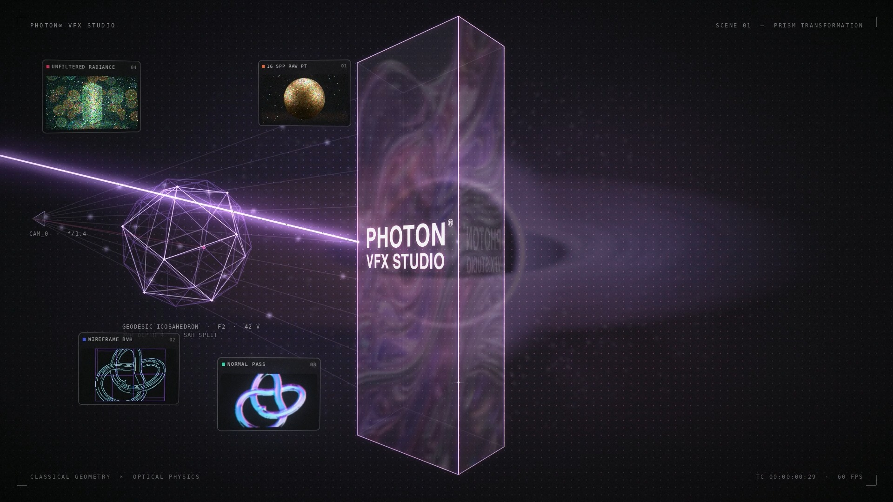

# Photon ☀️



Photon is a high-performance graphics, rendering, and path-tracing engine built with Dart and Flutter. This project implements complex optical simulations and physically based rendering (PBR) techniques to render photorealistic materials, volumetric lighting, and advanced physical phenomena.

## 🌟 Key Features

* **Physically Based Rendering (PBR):** Accurate material simulations using advanced Bidirectional Scattering Distribution Functions (BSDF).
* **Gravitational Lensing:** Real-time simulation of light bending around massive celestial bodies (e.g., black holes).
* **Subsurface Scattering:** Realistic light penetration and diffusion for translucent materials like jade and emerald.
* **Volumetric Rendering:** Simulation of light interacting with participating media (fog, prisms, atmospheric scattering).
* **Anisotropic Highlights:** Directional light reflections for brushed metals and chrome surfaces.
* **Caustics Simulation:** Dynamic, physically accurate light refraction and concentration patterns.

## 🏗️ System Architecture
System Architecture
| System Module | Core Components |
| :--- | :--- |
| **Scene Graph** | • Cameras <br> • Geometry / Meshes <br> • Light Sources |
| **Material System** | • BSDF Models <br> • Diffuse / Specular <br> • Anisotropic |
| **Core Engine** | • Ray Intersections <br> • Vector Math <br> • Photon Mapping |
| **Renderer Layer** | • Flutter Pipeline <br> • CustomPainter <br> • Fragment Shaders |
## 🖼️ Gallery

Explore the capabilities of the Photon engine:

* **Blackhole Lensing:** `assets/images/blackhole_lensing.png`
* **Caustic Waves:** `assets/images/caustic_wave.jpg`
* **Chrome Anisotropic:** `assets/images/chrome_anisotropic.png`
* **Emerald Subsurface:** `assets/images/emerald_subsurface.png`
* **Gold BSDF Sphere:** `assets/images/gold_bsdf_sphere.jpg`
* **Volumetric Prism:** `assets/images/volumetric_prism.png`

## 🚀 Getting Started

### Prerequisites

* [Flutter SDK](https://flutter.dev/docs/get-started/install)
* Dart SDK

### Installation

1. Clone the repository:
   ```bash
   git clone [https://github.com/mfarazcodes/photon.git](https://github.com/mfarazcodes/photon.git)
