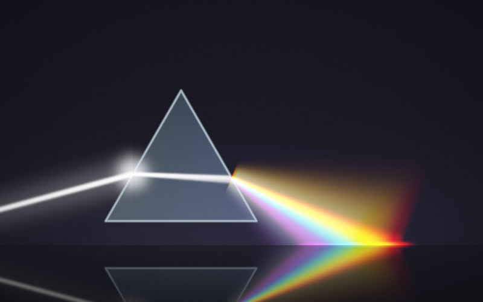

  

  # PHOTON® Spatial Studio
  ### Real-Time Neural Path-Tracing & Relativistic Optical VFX Interface

  
  
  
  
  

  

    <b>A deterministic light transport interface combining high-speed native rendering engines with an interactive spatial Flutter desktop frontend.</b>
  

---

## ✦ Overview

**PHOTON® Spatial Studio** is an architectural visual effects workbench designed to manipulate physical optics, spectral dispersion, and bounding volume hierarchy (BVH) structures in real time. 

Built with an interface inspired by the **Lusion.co** design system, PHOTON pairs real-time GPU/CPU path-tracing telemetry with full-duplex WebSocket streaming (`ws://127.0.0.1:8765`), offering deep physical light simulations without generative AI hallucinations.

---

## ✦ Key Architectural Features

### 1. Spatial Viewport (`SCENE_VIEWPORT.rt`)
* **Live Stream & Ingest:** Streams progressive frame buffers (`frame`, `raw_frame`) via low-latency binary WebSockets directly to the canvas.
* **A/B Wipe Curtain:** Split-screen comparison between raw Monte Carlo passes and hardware-accelerated OIDN denoised passes.
* **Pixel Loupe & IRE False Color:** Precision 8× sub-pixel magnifier inspecting radiance, cd/m² exposure, and IRE clipping.
* **Real-Time BVH Overlay:** Interactive 3-level bounding box hierarchy with Snell's law refraction ray tracking.

### 2. Physical Optics Engine
* **Cauchy Dispersion:** Dynamic Index of Refraction (IOR) dispersion from Crown Glass (1.52) to Liquid Metal / Diamond (2.417+).
* **Multiple Integrator Models:** Support for Unidirectional Path Tracing, Bidirectional MIS (BDPT), SPPM Caustics, and ReSTIR PT.
* **Continuous Tick Scrubbing:** Sub-pixel parameter cards for Aperture ($f/1.0$ – $f/16$), Focal Distance ($0.2\text{m}$ – $10.0\text{m}$), Bounces (1–32), and SPP convergence.

### 3. Spatial Card Deck & Ingest
* **3D Perspective Carousel:** A 3D matrix transform deck with velocity-based gesture swiping and tap-to-open full-screen inspection.
* **Spatial Ingest Portal:** Universal drag-and-drop ingest for OpenUSD (`.usd`), OpenEXR (`.exr`), `.bsdf`, `.ior`, and `.obj` geometry.

### 4. Lusion.co Design System
* **Coordinated Dual Themes:** Dark Grading (Void base `#0B0C10`, Slate hairline `#262936`) and Daylight Lab (Lavender base `#F0F1FA`, Crisp White surface).
* **Hardware Optical Switch:** Physical-style toggle with animated Sun (Daylight) and Crescent Moon (Dark) indicators.
* **Dot-Matrix Substrate:** Proximity-lit Gaussian cursor grid background.

---

## ✦ Repository Architecture

================================================================================
                    PHOTON® SPATIAL STUDIO — ARCHITECTURE BLUEPRINT
================================================================================

--------------------------------------------------------------------------------
1. HIGH-LEVEL SYSTEM TOPOLOGY
--------------------------------------------------------------------------------
   +------------------------------------------------------------------------+
   |                        FLUTTER DESKTOP CLIENT                          |
   |                     (Windows 11 · Dart 3 · M3 UI)                      |
   +------------------------------------------------------------------------+
        |                                                        |
        | (Local WebSocket Protocol)                             | (Win32 API Bridge)
        v                                                        v
   +-----------------------+                            +-------------------+
   |  JAVA WEBSOCKET SERVER|                            | WINDOWS 11 DWM    |
   |  (ws://127.0.0.1:8765)|                            | (Native Frame /   |
   +-----------------------+                            |  Dark/Light Theme)|
        |                                               +-------------------+
        v
   +-----------------------+
   | NATIVE WORKER BINARIES|
   | (Vulkan / CUDA Paths) |
   +-----------------------+

--------------------------------------------------------------------------------
2. FRONTEND ARCHITECTURAL LAYERS (Flutter / Clean State Partitioning)
--------------------------------------------------------------------------------
   [Presentation Layer]
      ├── SpatialCanvas (Master Layout Router: Desktop vs Companion Layouts)
      ├── MacWindowViewport (SCENE_VIEWPORT.rt & Interactive Canvas Overlay)
      └── TopTelemetryBar & CommandDock (Unified Controls & Model Selector)

   [Interactive UX / Gestural Components]
      ├── CardDeckCarousel (3D Matrix4 Perspective Swipe & Full-Screen Staging)
      ├── ShaderThemeSwitch (Hardware Optical Toggle with Sun/Moon Cross-Fading)
      └── IntentFileTrigger & FileIngestSheet (Modern Spatial Ingest Portal)

   [State & Data Layer (Single Source of Truth)]
      ├── StudioController (ChangeNotifier Managing Optics, History & Assets)
      ├── StudioScope (InheritedNotifier Providing Reactive Context)
      └── RenderSocket (Full-Duplex TCP WebSocket Client with Exponential Backoff)

--------------------------------------------------------------------------------
3. BACKEND & RENDERING PIPELINE (Java + Native Workers)
--------------------------------------------------------------------------------
   [Java WebSocket Server Pipeline]
      ├── PhotonServer (org.java_websocket Standalone Daemon on Port 8765)
      ├── Subprocess Process Manager (Spawns Local Worker Binaries Automatically)
      └── Binary Byte-Stream Bridge (Zero-Copy Frame Buffer Transmission)

   [Compute & Protocol Routing]
      ├── JNI / Local Subprocess Bridge (Job Dispatch & Render Payload Sync)
      ├── Model Context Protocol (MCP) Server (stdio/SSE Interface for AI Coding Tools)
      └── Remote GPU Cluster Node Dispatch (gRPC / mTLS over Cloud Compute Nodes)

--------------------------------------------------------------------------------
4. DESIGN SYSTEM & COLOR ARCHITECTURE (Lusion.co Design Language)
--------------------------------------------------------------------------------
   [Theme Tokens - PhotonPalette]
      ├── Dark Grading (Void: #0B0C10, Surface: #14151B, Substrate: #12141C)
      ├── Daylight Lab (Canvas: #F0F1FA, Surface: #E4E6EF, Substrate: #FFFFFF)
      └── Brand Accents (Electric Ultramarine: #1A2FFB, Hot Coral: #FF4C41)

   [Typography Engine - PhotonType]
      ├── Geist (UI, Headings, and Prose scaling)
      └── JetBrains Mono (Tabular Figures for jitter-free real-time convergence)
================================================================================
